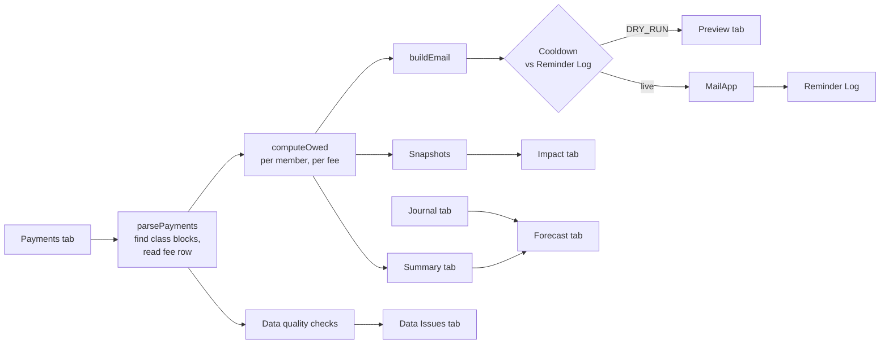

# Chapter Treasury

Dues tracking, validation, reporting, and collection reminders for a 140-member chapter's
Google Sheets payment tracker, built with Google Apps Script.

## The problem

A chapter's social dues live in a shared spreadsheet: one row per member, one column per
fee (Social Fee $650, Formal $550, Pig Roast $350), and cells typed by hand as `Paid`,
`Not Paid`, or an amount paid so far. With 140 members, the treasurer has to:

- work out who owes what (including partial payments) by eye,
- chase people individually,
- notice typos like `pd` or an overpayment before they skew the totals,
- and answer "are we going to have enough money for Formal?" without a real forecast.

## The solution

One script turns the existing sheet into a small accounts-receivable system, with no
change to how the treasurer records payments:

| Tab it maintains | What it shows |
|---|---|
| **Preview** | Every reminder that would be sent, in full, before anything goes out |
| **Reminder Log** | Each email actually sent: who, when, and for how much |
| **Data Issues** | Cells and rows that need fixing: unrecognized values, overpayments, missing or invalid emails, duplicates |
| **Summary** | Billed, collected, outstanding, and collection rate by fee and by class, plus the largest balances |
| **Impact** | Response rate, members paid in full, and dollars collected after reminders, plus outstanding balance over time |
| **Forecast** | Each event's projected income against its spending (from the Journal tab) or budget, with surplus or shortfall |

Each member who owes money gets one personal email listing only what they owe:

```
Hi Member,

This is a reminder that you have an outstanding balance for 2026-2027 social dues:

  Social Fee: $650.00
  Pig Roast: $250.00 (paid $100.00 of $350.00)
  Total: $900.00

You can pay your balance through Billhighway:
https://www.billhighway.com

If you think this is a mistake, just reply to this email.

Thanks,
Social Chair
```

## How it works



1. **Parse.** The Payments tab is read as a 2D array. Class blocks (FRESHMEN, SOPHOMORE,
   JUNIOR, SENIOR) are found by their header rows, not fixed row numbers, so adding
   members never breaks anything. Fee amounts are read from row 3, so a fee change in the
   sheet flows through everywhere.
2. **Compute.** Each fee cell becomes an amount owed:

   | Cell | Owed |
   |---|---|
   | `Paid` | 0 |
   | `Not Paid` | full fee |
   | a number (e.g. `300`, `$325`) | fee minus amount, never below 0 |
   | blank | not billed yet, so 0 (set `BLANK_MEANS_NOT_PAID: true` to treat as unpaid) |
   | anything else (`pd`) | not counted, and flagged on Data Issues |

3. **Remind.** Members with a balance and a valid email get an itemized email. Anyone
   emailed in the last `COOLDOWN_DAYS` is skipped, so re-running the script or a weekly
   trigger never double-sends. Sending stops at the daily Gmail quota and the rest go
   out on the next run.
4. **Report.** Every run rebuilds Summary, Data Issues, Impact, and Forecast. Live runs
   also save a snapshot of every balance, which is what lets Impact compare each
   reminder against the member's balance on the following run.

## Project layout

```
src/
  Config.js     settings: dry-run flag, column map, fees, email text, cooldown, budgets
  Dues.js       pure: parse the Payments tab, compute owed, build emails
  Quality.js    pure: roster-wide data checks
  Reminders.js  pure: reminder log + cooldown
  Reports.js    pure: summary, impact, forecast
  Code.gs       Apps Script entry points and sheet/mail I/O
tests/          Node tests, including one that runs Code.gs against a fake spreadsheet
sample-data/    fake roster and journal that mirror the real sheet layout
```

## Setup

Requires Node 20+ and [clasp](https://github.com/google/clasp).

```bash
npm install -g @google/clasp
clasp login
cp .clasp.json.example .clasp.json   # add the Script ID of the sheet's bound Apps Script project
clasp push
```

Add an `Email` column (column F by default) to the Payments tab, then review
`src/Config.js`: column letters, class names, sender name, payment link, and the Journal
column headers.

## Running it

| Function | What it does |
|---|---|
| `sendDuesReminders()` | Builds reminders, then previews or sends, then refreshes all reports |
| `refreshReports()` | Rebuilds the report tabs without touching email |
| `installWeeklyTrigger()` | Schedules `sendDuesReminders` for Monday at 9am |

**Dry run is the default.** With `DRY_RUN: true`, nothing is emailed: every would-be
message is written to the Preview tab with a status (`Would send` or
`Skipped: emailed <date>`). To send for real, set `DRY_RUN: false` in `Config.js`.

## Tests

```bash
npm test
```

Uses Node's built-in test runner, with no dependencies. Coverage includes every cell format
(paid, unpaid, partial, overpaid, blank, unrecognized), class block detection, fee
amounts read from the sheet, email itemization and totals, cooldown timing, impact math,
Journal parsing, and forecast scenarios. `tests/code.test.js` loads the real Apps Script
files into a Node VM with fake `SpreadsheetApp` and `MailApp` services, then checks that a
dry run sends nothing, a live run logs every send, the cooldown holds on re-run, and the
quota is respected.

## Design decisions

- **Pure core, thin shell.** All parsing and math live in plain functions that take 2D
  arrays and return data. Only `Code.gs` touches Google services. That keeps the logic
  unit-testable in Node, and the same files run unchanged in Apps Script (shared globals)
  and Node (`module.exports`, guarded by `typeof module`).
- **Safe by default.** Dry run is on until someone deliberately turns it off. Live
  sends are logged one at a time, so a mid-run failure can't cause duplicates on retry.
- **Flag, don't guess.** An unrecognized cell is excluded and reported rather than
  interpreted. A wrong reminder costs more trust than a late one.
- **Read the sheet, not constants.** Fees come from the fee row, class blocks from their
  headers, and Journal columns from header text.
- **Privacy.** No member data is stored in this repository. Sample data is fictional
  (`Member 01`, `member01@example.com`).

## License

MIT
